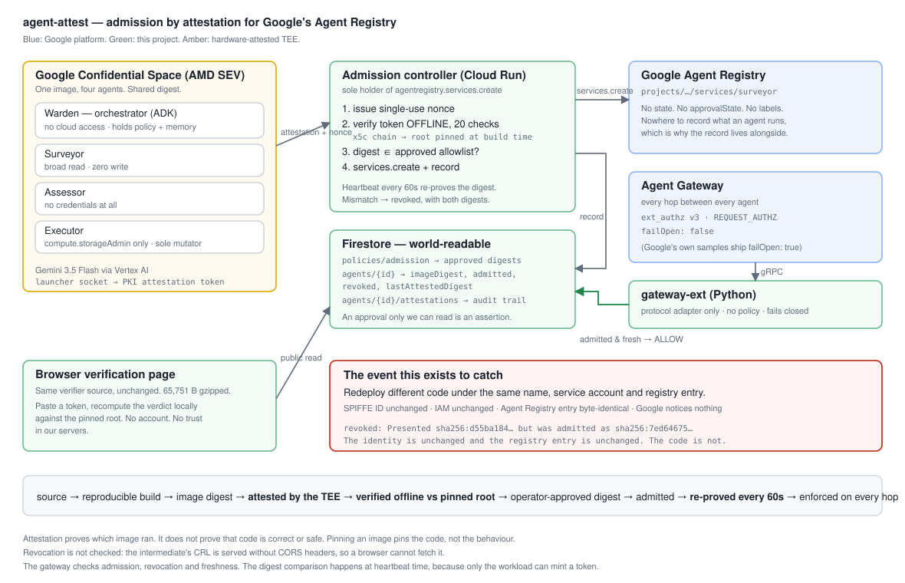

# agent-attest

**Google's Agent Registry knows where an agent runs. It doesn't know what code runs there.**

Try it: **[agent-attest.pages.dev](https://agent-attest.pages.dev)** ·
**[4 min demo](https://www.youtube.com/watch?v=mD6cvaFkFEc)**

An agent gets into the registry because somebody with the right IAM role deployed it. Agent
Identity then gives that agent a SPIFFE ID which Google's docs describe as "mapped directly
to the resource URI where the agent is hosted". So redeploy completely different code to the
same resource URI and you get the same SPIFFE ID, the same IAM authority, and a registry
entry that hasn't changed. Nothing in the platform notices.

agent-attest fixes that. Agents run as workloads on Google Confidential Space and have to
present an attestation token to get in. That token is checked offline, against a Google root
certificate pinned into the binary at build time, before the agent is registered. The digest
it was admitted under gets recorded, and every 60 seconds the agent has to prove it's still
running that same digest.

> source → reproducible build → image digest → attested by the TEE → verified offline
> against a pinned root → approved digest → admitted → re-proved every 60 seconds

This builds on Google's platform rather than replacing it. Registration goes into the real
Agent Registry (`agentregistry.googleapis.com`). The enforcement path is a real Agent Gateway
authorization extension, registered but not yet bound, and the Status table below says exactly
how far that got. The bit I added is the admission step in between.

## Who I built this for

Not the engineer who wants to run an agent fleet. The person who has to approve it.

Every organisation has someone whose job is to sign off before something touches production.
They are not on the agent team, they usually can't read the agent's code, and they are the
reason most of these fleets are still sitting in a staging project. Right now the only
question they can actually get an answer to is "who deployed this", because that is the only
question the platform answers. The question they need answered is "what is it running", and
nobody can tell them.

So they say no. Not out of obstruction, but because saying yes would mean vouching for
something they have no way of checking.

agent-attest is for that person. It turns an approval they have to take on trust into one
they can verify themselves, from a browser, with no account and no access to my
infrastructure. That is why the admission records are world-readable and why the verifier
runs client-side. An approval only the approver's own vendor can read is not an approval.

## The fleet, and what stops a worker going wrong

Autonomous cloud estate hygiene. Warden orchestrates and holds the policy, Surveyor inventories
the estate read-only through Cloud Asset Inventory, Assessor reasons about blast radius with no
estate access whatsoever, and Executor performs one approved removal. Executor is the only
agent in the project with any mutating permission, and it holds `compute.storageAdmin` rather
than `compute.admin`, so it can delete a disk and not an instance. No agent holds two of those
powers, and the split is IAM rather than instruction text. Every grant is in
`deploy/00-bootstrap.sh`.

Workers are `RemoteA2aAgent`, so every delegation is a network hop that can be checked.
In-process sub-agents would be simpler and would prove nothing, because the whole claim is
that admission gets checked on the hop.

What Warden does when a worker misbehaves is in `agents/warden/agent.py`. One of these
defences is permissions, one is code, and three are instructions to a model. That distinction
is real and I have labelled it, because an instruction is a request and a permission is not.

- **PERMISSIONS. Assessor cannot act on its own reasoning.** No estate access, so the agent
  doing the thinking has no way to touch anything. A hallucination there is a wrong opinion
  and nothing more. Holds even if the model ignores every word of its instruction.
- **CODE. `before_tool_callback` refuses to delegate to a worker Warden believes is revoked.**
  `refuse_unadmitted_workers`, on every delegation.
- **INSTRUCTION. A vague assessment is not an assessment.** Warden is told to accept one only
  if it cites the same finding id that was sent and reaches an explicit safe or unsafe
  conclusion with a stated reason, and to discard anything else.
- **INSTRUCTION. Findings go across verbatim,** since Assessor cannot see the estate and
  anything paraphrased is information it will never have.
- **INSTRUCTION. No retries and no routing around a failed worker,** and doing nothing is
  named as the always-safe branch, because the cost of a wrong deletion is unbounded and the
  cost of a missed cleanup is a small ongoing bill.

There are two layers of admission checking and today only one of them runs. Warden's
`before_tool_callback` **fails open on purpose**, because it runs inside the agent whose
behaviour is in question and anything that compromises Warden removes it. The design puts the
real check at the gateway, which fails closed and runs somewhere the caller does not control.
That gateway check is built and registered but never got bound, so the delegation hop is
currently guarded by the fast-fail callback and by IAM, and not by the gateway. See
[docs/GATEWAY.md](docs/GATEWAY.md), which does not flatter me.

## Which Google agent platform components it uses

Google's agent platform has seven components. Here is what I actually used, including the ones I
didn't, because a checklist answered honestly is more useful than one answered generously.

| Component | Used | What I did |
|---|---|---|
| **Agent Registry** | yes | Four agents in the real registry, each one there because an attestation verified. This is the centre of the project. |
| **Agent Identity** | yes, as the subject | The whole project is an argument about what a SPIFFE ID does and does not prove. It proves where. It does not prove what. |
| **Agent Gateway** | partly | Real `authzExtension` and gateway resources, verified against Envoy `ext_authz` v3 protos. The policy binding never completed. See [docs/GATEWAY.md](docs/GATEWAY.md). |
| **Agent Observability** | partly | Append-only, world-readable attestation trail with per-check results on every heartbeat. It is a durable audit log. It is not OpenTelemetry instrumented, and I'm not going to call it that. |
| **Agent Runtime** | no | The workload has to mint its own hardware attestation, which means it has to be the thing running in the TEE. That rules out a managed runtime for the fleet itself. The control plane does run on Cloud Run. |
| **Memory Bank** | no | There is no exemption store. Warden's instruction tells it to check its memory before acting on a resource a human has exempted, and nothing implements that memory. I found that writing this table rather than designing it in. The state that genuinely has to survive weeks is the admission and attestation record, and that is in Firestore. Memory Bank is where the exemption list belongs and it is the next thing I would build. |
| **Model Armor** | no | Orthogonal rather than skipped. Model Armor guards what goes into and out of a model. Attestation guards what the code is. Model Armor stops an injection changing what an agent does; attestation stops a redeploy changing what an agent is. Neither substitutes for the other, and a fleet that wants to be trusted needs both. |

## Architecture



## Status

| Part | State |
|---|---|
| Offline Confidential Space attestation verifier, 20 checks | **Live.** 17 tests: 15 against a real production token from a TEE in this project, one against a deliberately forged chain, one against the pinned root itself. |
| Admission into Google's Agent Registry | **Live.** Four agents registered because an attestation checked out. |
| Heartbeat re-attestation, revocation on drift | **Live.** Caught in about 60 seconds, end to end. |
| Browser verification page | **Live** at [agent-attest.pages.dev](https://agent-attest.pages.dev). |
| ADK fleet on Confidential Space | **Live.** Orchestrator plus three specialised workers. |
| Agent Gateway authorization extension | **Registered.** Real `authzExtension` resource, checked against Envoy `ext_authz` v3. |
| Gateway policy binding | **Blocked.** Tenant provisioning never completed, and the protocol enum has no A2A. See [docs/GATEWAY.md](docs/GATEWAY.md). |

## Layout

| Path | What's in it |
|---|---|
| `verifier/` | Confidential Space attestation verification. Pure WebCrypto, offline PKI (`x5c`) path, no backend. Runs unchanged in a browser and in Node. About 66 kB gzipped, measured by `web/build.sh`. The exact byte count moves slightly between gzip implementations. |
| `control-plane/` | Admission controller. Verifies, calls `services.create`, writes the admission record. |
| `gateway-ext/` | Agent Gateway authorization extension. The gRPC callout that allows or denies. |
| `agents/` | The fleet: Warden, Surveyor, Assessor, Executor. |
| `web/` | The verification page. |
| `deploy/` | Numbered scripts, run in order. |
| `tools/attestation-vm/` | Takes a Confidential Space VM from nothing to a real attestation token. |
| `docs/` | Schema, gateway notes, architecture diagram. |

## One verifier, two places

`verifier/` has no DOM dependency and no Node-only dependency, so the same code runs in the
Cloud Run control plane and in a browser. That means you can recompute the control plane's
verdict yourself, client-side, against the pinned root, without an account and without
trusting my servers.

There's no second browser implementation. Two implementations that agree would only prove I
can write two things that agree.

## Spin-up

You'll need: a Google Cloud project with billing enabled, `gcloud`, Docker, and Node 20+.
Confidential Space needs AMD SEV capable hardware (the n2d family), so pick a region that
has it.

```bash
git clone https://github.com/iamrobertmoore/agent-attest
cd agent-attest
export PROJECT=your-project-id
```

**1. Bootstrap.** APIs, Firestore, six service accounts with deliberately non-overlapping
IAM grants.

```bash
./deploy/00-bootstrap.sh
```

**2. Firestore rules.** Admission records are world-readable on purpose; the control plane
writes with admin credentials, which bypass rules.

```bash
./deploy/10-firestore-rules.sh   # prints the rules and how to apply them
```

**3. Control plane.** Deploys to Cloud Run as the only principal in the project holding
`agentregistry.services.create`.

```bash
./deploy/20-control-plane.sh
```

**4. Launch an agent.** Builds the fleet image, approves its digest, and launches it on
Confidential Space. Before it spends a VM it checks the image is single-platform, diffs
every env var against the launch policy, and boots the container locally.

```bash
./deploy/30-agent-vm.sh surveyor
for a in assessor warden executor; do SKIP_BUILD=true ./deploy/30-agent-vm.sh $a; sleep 20; done
```

**5. Check it worked.** No credentials needed for the second one.

```bash
curl -s -H "Authorization: Bearer $(gcloud auth print-access-token)" \
  "https://agentregistry.googleapis.com/v1/projects/$PROJECT/locations/us-central1/services"

curl -s "https://firestore.googleapis.com/v1/projects/$PROJECT/databases/(default)/documents/agents/surveyor"
```

**6. See it catch a change.** Redeploys one agent with different code, under the same name
and identity, never approved. About 90 seconds to run, of which detection is the last 60.

```bash
./deploy/40-drift-demo.sh assessor
```

**Optional: the gateway.** VPC, internal load balancer, private DNS, authorization
extension, gateway. Read [docs/GATEWAY.md](docs/GATEWAY.md) first, it explains what does and
doesn't work.

```bash
./deploy/50-gateway.sh
```

**Run the tests:**

```bash
cd verifier && npm install && npm test    # 17 tests, 15 of them against a real TEE token
```

**Build the page locally:**

```bash
./web/build.sh
cd web/dist && python3 -m http.server 3000
```

**Tear down** so you stop paying for VMs:

```bash
for a in surveyor assessor warden executor; do
  gcloud compute instances delete agent-attest-$a --zone=$(cat deploy/.zone-$a) --quiet
done
```

## What this doesn't do

These are in the code as `STANDING_CAVEATS` and `REGISTRY_CAVEATS`, and they get printed
with every result including the ones that pass.

- Attestation proves which image ran. It doesn't prove the code is any good. A TEE running
  malicious code produces a perfectly valid attestation.
- Pinning an image pins the code, not the behaviour. Nothing here covers model weights or
  prompts pulled in at runtime from somewhere else.
- Revocation isn't checked. The leaf has no CRL distribution point, and the intermediate's
  CRL is served without CORS headers so a browser can't fetch it. With 60-day leaves and a
  hard root pin the residual risk is a revoked intermediate. Rare, not zero.
- The gateway doesn't re-attest per request, because only the workload can mint a token and
  the caller isn't the workload. It checks admission, revocation and freshness. The digest
  comparison happens on the heartbeat, so an agent that drifts inside the 300-second window
  stays reachable until it misses a beat.
- Verifying in your browser means you don't have to trust the server running the workload.
  You do still have to trust whoever served you the JavaScript.

## Prior work

The verifier started as the Confidential Space verifier from an earlier project of mine,
[glassbox](https://github.com/iamrobertmoore/glassbox), reused here under MIT with the
registry binding rewritten from an on-chain lookup to Firestore. The attestation capture
tooling has the same origin.

## Licence

MIT. See `LICENSE`.
